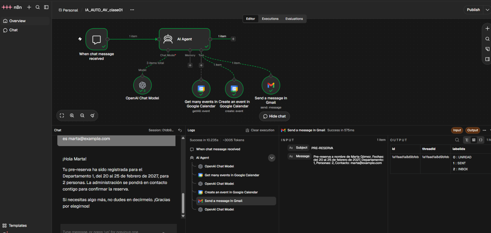

# Agente de IA para reservas de alojamiento turístico

Primera versión (checkpoint 1) de un agente de IA hecho en **n8n** que atiende consultas de huéspedes, revisa la disponibilidad en un calendario y registra pre-reservas. Todos los datos de este proyecto son **ficticios**.

## Cómo funciona
1. El huésped escribe por chat (Chat Trigger).
2. El **AI Agent** (modo Tools Agent, modelo GPT-4o, máximo 5 iteraciones) interpreta el pedido.
3. Consulta **Google Calendar** para saber qué departamentos están ocupados (hay 4).
4. Si hay lugar, crea el evento "PRE-RESERVA - nombre - Depto N".
5. Envía un aviso por **Gmail** a la administración (registro de lo que hizo el agente).

## Qué incluye
- System Message modular: Rol, Ámbito, Objetivo, Reglas y Escalamiento.
- 3 herramientas con descripciones detalladas: ver eventos, crear evento y enviar mail.
- Reglas para no inventar disponibilidad ni confirmar pagos.

## Cómo probarlo
1. Importá `checkpoint1_Carla_Maguiña.json` en n8n (menú ⋯ > Import from file).
2. Conectá tus propias credenciales de OpenAI, Google Calendar y Gmail.
3. Cambiá el calendario y el mail de destino por los tuyos.

## Próximos pasos
Memoria por huésped, más integraciones, base documental (RAG) y voz.

*Proyecto del curso IA Automation Avanzado (Coderhouse).*
